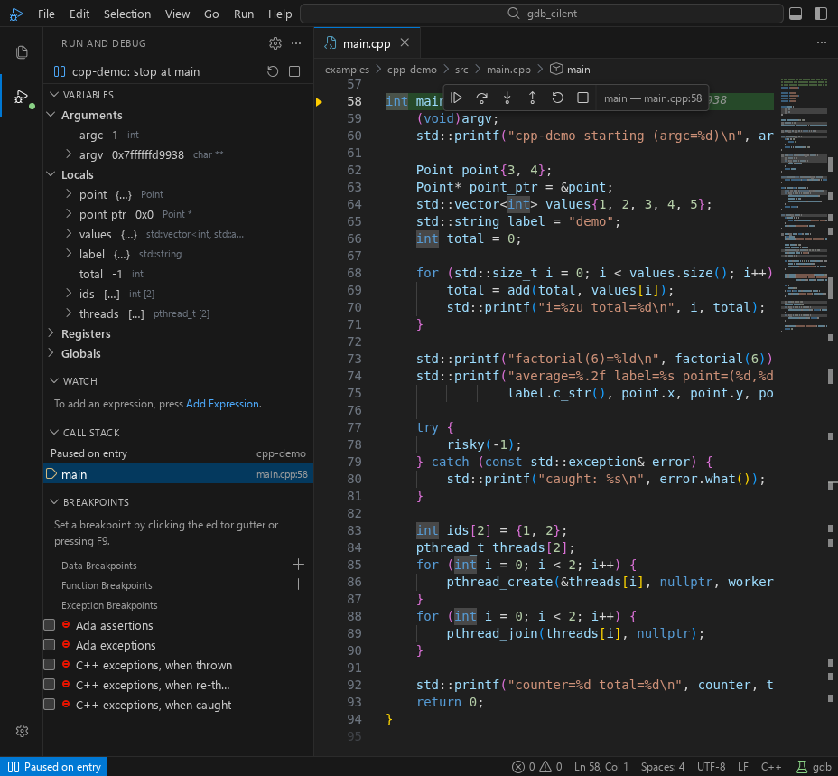
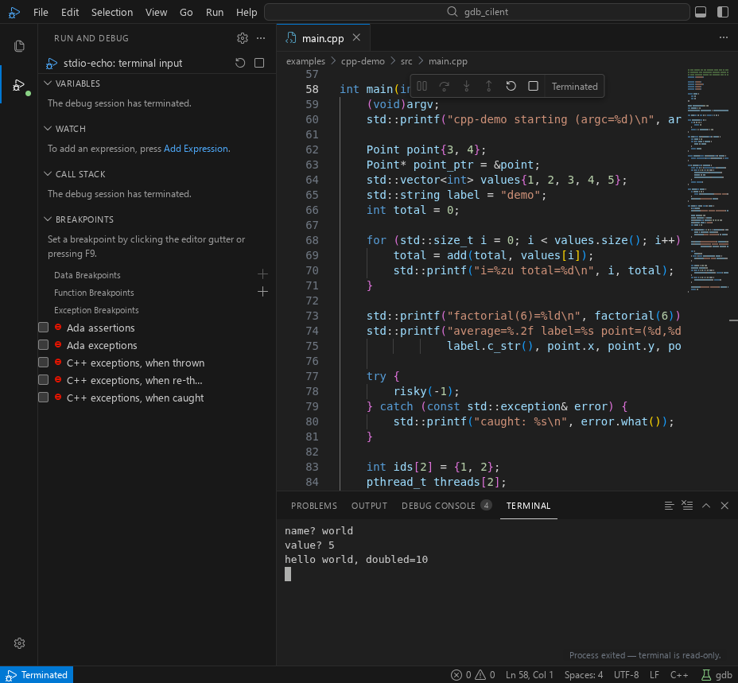

# vsc_dbg_cilent

> **玩具项目声明 / Toy project notice**
>
> 这是一个玩具项目，由大型语言模型（LLM）生成，仅用于学习和演示，未经生产级审查，请勿用于生产或关键场景。
>
> This is a toy project generated by a large language model (LLM). It is for
> learning and demonstration only and has not been reviewed for production use.

Repository: [Shyliuli/vsc_dbg_cilent](https://github.com/Shyliuli/vsc_dbg_cilent)
— the application itself is internally named **gdb-client**.

A toy VS Code-style GDB debugger that runs in the browser. The front end is a
full [Debug Adapter Protocol](https://microsoft.github.io/debug-adapter-protocol/)
client; the adapter is **gdb itself** (`gdb --interpreter=dap`, gdb 14+), so
launch/attach, breakpoints, stepping, variables, disassembly and memory all use
the same protocol semantics VS Code uses.

The goal is a faithful reproduction of VS Code's GDB debugging surface: the
workbench layout, the Run and Debug view, breakpoints with conditions / hit
counts / log messages, call stack and threads, variables with registers and
watch expressions, hover evaluation, inline values, the debug console, the
disassembly view and a memory viewer.



## Requirements

- Linux (the process picker and attach flow use `/proc`).
- `gdb` 14 or newer with the built-in DAP interpreter. gdb 17.2 is what this
  repository is developed and tested against.
- Node.js 24 or newer. The repository runs TypeScript sources directly through
  Node's type stripping; Vite builds the browser bundle.
- A C/C++ toolchain (`g++`, `make`) to build the demo programs.
- `python3` on `PATH` for the integrated terminal (`console: "integratedTerminal"`);
  gdb's DAP interpreter itself requires Python, so this is normally already true.

Check that your gdb speaks DAP:

```console
$ gdb --version | head -1
GNU gdb (GDB) 17.2
```

## Quick start

```console
npm install
make -C examples/cpp-demo          # build the main demo target
make -C examples/stdio-echo        # build the stdin/terminal demo
npm run build                      # typecheck + bundle web assets into dist/
npm start                          # http://127.0.0.1:3000
```

Open <http://127.0.0.1:3000>. The server binds to `127.0.0.1` by default; set
`HOST` / `PORT` / `GDB_CLIENT_WORKSPACE` to change that.

Development (Vite HMR + backend watch):

```console
npm run dev        # backend :3000, web :5173
```

Then open <http://localhost:5173>; the dev server proxies `/api` and `/ws` to the
backend.

### Production build

The optimized bundle is still a toy project — see the notice at the top.

```console
npm run check        # typecheck + tests
npm run build        # typecheck + web bundle in dist/
npm start            # http://127.0.0.1:3000
```

Environment: `HOST` (default `127.0.0.1`), `PORT` (default `3000`),
`GDB_CLIENT_WORKSPACE` (default: current directory). `GET /api/health` returns
`{"ok":true}` for readiness checks. Keep the server on loopback: it can spawn
gdb, attach to processes and read files as your user. If remote access is
required, put it behind an authenticating, loopback-only reverse proxy.
`npm test` needs gdb, `python3`, and a C/C++ toolchain (the end-to-end suite
builds the demos and drives real gdb).

## Using it

1. Pick a configuration in **Run and Debug** (or press `F5`).
2. Click the editor glyph margin or press `F9` to set a breakpoint. Right-click
   the gutter for conditional breakpoints, logpoints, run-to-cursor, and the
   disassembly view.
3. When the program stops, inspect **Variables** (Arguments, Locals, Registers,
   Globals), add expressions to **Watch**, switch frames, and hover values in
   the editor. Inline values appear at the end of the stopped line.
4. **Debug Console** evaluates expressions and runs gdb commands (`p x`,
   `info registers`, `x/4xw &counter`, `set confirm off`, …).
   To let the debugged program read stdin, use a configuration with
   `"console": "integratedTerminal"`; program output and input then live in the
   **Terminal** panel (see [Console modes](#console-modes)).
5. **Open Disassembly View** (Run menu, command palette, or editor context menu)
   shows the current function, follows the program counter, and accepts
   instruction breakpoints in the gutter.
6. **View Memory** opens a hex/ASCII page at `$sp` or at any expression; pointer
   variables in the Variables view have a "View Memory" action.

The demo launch configurations live in `.vscode/launch.json` and target
`examples/cpp-demo/build/cpp-demo`.

### Keyboard shortcuts

| Shortcut | Action |
| --- | --- |
| `F5` | Start / continue |
| `Shift+F5` | Stop |
| `Ctrl+Shift+F5` | Restart (terminate + relaunch, breakpoints preserved) |
| `F6` | Pause |
| `F9` | Toggle breakpoint |
| `F10` / `F11` / `Shift+F11` | Step over / into / out |
| `Ctrl+F10` | Run to cursor |
| `Ctrl+Shift+P` / `F1` | Command palette |
| `Ctrl+P` | Go to file |
| `Ctrl+Shift+D` / `Ctrl+Shift+E` | Run and Debug / Explorer |
| `Ctrl+Shift+Y` | Debug Console |
| `Ctrl+B` / `` Ctrl+` `` | Toggle sidebar / panel |
| `Ctrl+S` / `Ctrl+W` | Save / close editor |

## Feature coverage

| VS Code GDB feature | Status | Notes |
| --- | --- | --- |
| `launch.json` configurations, config picker, `F5` | ✅ | JSON with comments; platform blocks; `setupCommands`; `${workspaceFolder}` / `${file}` / `${env:…}` substitution |
| Launch with `program`, `args`, `cwd`, `env`, `environment` | ✅ | Demonstrated by the demo configs |
| Attach by pid, attach process picker, remote `target` | ✅ | `${command:pickProcess}` in `processId` opens the picker |
| `stopAtEntry` / `stopOnEntry` | ✅ | `stopAtEntry` → `start` (main), `stopOnEntry` → `starti` |
| Line breakpoints (add/remove/enable/disable) | ✅ | Shared by editor gutter and Breakpoints view |
| Conditional breakpoints, hit counts | ✅ | `condition`, `hitCondition`; hit count maps to gdb's ignore count |
| Logpoints | ✅ | `{expression}` interpolation, output in Debug Console |
| Function breakpoints | ✅ | Add from Breakpoints view or command palette, with conditions |
| Exception breakpoints (C++ throw/rethrow/catch, Ada) | ✅ | Filters and per-filter conditions come from gdb's capabilities |
| Instruction breakpoints | ✅ | Set from the Disassembly view gutter |
| Call stack, frame selection, frame paging | ✅ | Source reveal on stop and on frame selection |
| Threads and thread switching | ✅ | Dropdown in Call Stack; duplicate names are disambiguated with `(#id)` |
| Variables: Arguments / Locals / Registers / Globals | ✅ | Lazy loading and paging; aggregates show `{…}` when gdb returns no summary |
| Variable paging and expansion | ✅ | 100 items per page with "Load more…" |
| Set variable value | ✅ | Double-click a value or use the row action |
| Watch expressions | ✅ | Add/edit/remove, evaluated in the selected frame, expandable |
| Hover evaluation | ✅ | `context: "hover"` (gdb disables writes/calls for these) |
| Inline values | ✅ | Rendered for identifiers on the stopped line |
| Debug Console: expressions and gdb commands | ✅ | Expression first, then gdb command interpretation |
| Continue / pause / step over / into / out / restart / stop | ✅ | Restart is terminate + relaunch, like cpptools |
| Run to cursor | ✅ | Temporary breakpoint that is removed on the next stop |
| Disassembly view with follow-PC and source links | ✅ | gdb numeric `disassemble` from the resolved function start |
| Memory view (hex + ASCII, paging, address expressions) | ✅ | Read-only, backed by `readMemory` |
| Debug Console / Output / Problems panel | ✅ | Output also exposes the in-memory DAP trace |
| Command palette, go-to-file, quick input, notifications | ✅ | |
| launch.json editor with JSONC highlighting and "Add Configuration…" | ✅ | Validation errors are surfaced in Problems |
| Explorer, open editors, preview tabs, breadcrumbs, status bar | ✅ | |
| Reverse debugging (step back) | ❌ | gdb's DAP interpreter has no step-back requests |
| Data breakpoints / watchpoints | ✅ | Client-side mapping to gdb `watch` / `rwatch` / `awatch`; see [Data breakpoints](#data-breakpoints-watchpoints) |
| Program stdin / interactive programs | ✅ | `"console": "integratedTerminal"` allocates a pty for the inferior; `internalConsole` (the default) has no stdin, exactly like VS Code |
| External terminal | ❌ | No native terminal window is spawned; `externalConsole` is reported and ignored |
| `preLaunchTask` / `postDebugTask` | ❌ | Reported as a configuration warning; build before starting |
| Multiple concurrent sessions / compound configurations | ❌ | One active gdb session at a time |
| C++ IntelliSense / language server | ❌ | The editor is Monaco with syntax highlighting and debug hovers |

## Security

This is a local developer tool. The server binds `127.0.0.1`, rejects
cross-origin REST requests and WebSocket handshakes, and restricts all writes to
the workspace. The integrated terminal runs a small `python3` pty helper as your
user. Do not expose it on a network interface: anyone who can reach it can start
gdb, attach to processes and read files as your user.

## Console modes

VS Code separates where the debuggee's stdio lives. gdb-client implements the two
modes that matter:

| `console` | Program stdin | Program stdout/stderr | gdb messages |
| --- | --- | --- | --- |
| `internalConsole` (default) | not attached | Debug Console | Debug Console |
| `integratedTerminal` | **Terminal panel (pty)** | Terminal panel | Debug Console |

With `integratedTerminal`, the backend allocates a pty and adds
`set inferior-tty <pty>` to the launch setup before the inferior starts. The
Terminal panel is a real xterm.js terminal: type input, use arrow keys, Ctrl+C,
resize, and ANSI colors all work. `examples/stdio-echo` demonstrates this; its
configuration is `stdio-echo: terminal input` in `.vscode/launch.json`.



Attach configurations cannot rewire an already-running process's terminal, so
`integratedTerminal` falls back to `internalConsole` with a warning for
`request: "attach"`.

## Data breakpoints (watchpoints)

gdb's DAP interpreter has no `setDataBreakpoints` request, so data breakpoints
are implemented on the client and mapped onto gdb's watchpoint commands. They
stop when memory is written, read, or either:

1. Pause the program.
2. Right-click a variable in **Variables** or **Watch** and choose
   **Break on Value Change** (write), **Break on Value Read**, or
   **Break on Value Read/Write**.
   You can also use **Breakpoints → Data Breakpoints → +**, the command palette
   (**Debug: Add Data Breakpoint**), or the Run menu.

The stop is reported as "Paused on data breakpoint: <expression>", the matching
data breakpoint is highlighted, and the watchpoint appears in the breakpoint
list. Because gdb evaluates the expression in the selected frame, adding,
removing, enabling and disabling data breakpoints requires a paused program.
They are session-scoped: the list is cleared when the session ends or restarts.
Hardware watchpoints are limited by the CPU debug registers (typically a handful
at a time); gdb may fall back to software watchpoints for some targets.

## `launch.json` fields

Supported: `name`, `type` (ignored, any value), `request` (`launch` | `attach`),
`program`, `args`, `cwd`, `env`, `environment`, `console`
(`internalConsole` | `integratedTerminal`), `stopAtEntry`,
`stopOnEntry`, `stopAtBeginningOfMainSubprogram`, `miDebuggerPath`,
`miDebuggerArgs`, `setupCommands`, `customLaunchSetupCommands`,
`additionalSOLibSearchPath`, `sourceFileMap`, `processId` / `pid`, `target`,
`MIMode` (must be `gdb` if present), and platform blocks (`linux`, `osx`,
`windows`).

Recognized but unsupported and reported as warnings: `externalConsole`,
`console` other than the two modes above, `preLaunchTask`, `postDebugTask`,
`pipeTransport`, `symbolSearchPath`. Unknown fields are ignored, like VS Code
does for adapter-specific configuration.

`${workspaceFolder}`, `${workspaceRoot}`, `${workspaceFolderBasename}`,
`${file}`, `${relativeFile}`, `${fileBasename}`, `${fileBasenameNoExtension}`,
`${fileDirname}`, `${fileExtname}`, and `${env:NAME}` are expanded. `${input:…}`
and `${config:…}` are not; they are reported as warnings.

## Repository layout

```
server/            Node backend: static files, REST API, DAP↔WebSocket bridge
  dap/framing.ts   Content-Length framing codec
  dap/gdbSession.ts one gdb --interpreter=dap child process per session
  dap/bridge.ts    browser WebSocket ↔ gdb stdin/stdout, terminal control channel
  ptyBridge.ts     pty allocation + master↔browser bridge (server/pty_helper.py)
  launchConfig.ts  JSONC parsing, variable substitution, validation
  workspace.ts     workspace file API and traversal protection
  processes.ts     /proc-based attach picker data
shared/types.ts    types shared by backend and frontend (no runtime code)
src/               React front end
  dap/client.ts    DAP client (sequencing, correlation, events, control)
  debug/           zustand store, controller (session logic), types, helpers
  components/      workbench UI (sidebar, editor, panel, overlays)
  editor/          Monaco setup, hover provider, active-editor registry
  styles/          VS Code Dark Modern theme
examples/cpp-demo  demo program (structs, vector, recursion, threads, exception)
examples/stdio-echo interactive stdin/stdout demo for the integrated terminal
test/              unit and end-to-end tests
```

The server runs TypeScript directly (Node type stripping), so `npm start` does
not need a build step; `npm run build` only produces the browser bundle.

## Tests

```console
npm run check     # typecheck + tests
```

- `test/framing.test.ts` — DAP framing: split chunks, multiple messages,
  UTF-8 byte lengths, malformed headers/bodies.
- `test/launch-config.test.ts` — command-line splitting, variable substitution,
  JSONC parsing, configuration normalization, console modes, platform overrides,
  invalid configurations, launch.json read/write.
- `test/watchpoints.test.ts` — watchpoint command mapping, watchpoint-number
  parsing, and the `info watchpoints` fallback.
- `test/dap-bridge.test.ts` — starts the real server and gdb and drives DAP over
  WebSocket: initialize/launch, conditional breakpoints, logpoints, exception
  breakpoints, function breakpoints, hit counts, stepping, variables and paging,
  registers, `setVariable`, evaluate, disassembly, `readMemory`, exit,
  disconnect, attach to a live process, **pty stdin** (allocates an integrated
  terminal and feeds `world\n`/`5\n`), and **watchpoints** (sets
  `watch counter`, waits for a `data breakpoint` stop, then deletes it through
  the same commands the UI uses).

The end-to-end suite builds both demo programs and uses the real gdb you have on
`PATH`. All 26 tests pass in this repository (gdb 17.2, LoongArch host).

## Limitations and deviations

These come from gdb's DAP interpreter or from deliberate scope decisions. They
are listed here so nothing is silently missing:

- **Program stdin needs the integrated terminal.** gdb's DAP interpreter points
  the inferior at `/dev/null`; with `"console": "integratedTerminal"` gdb-client
  allocates a pty instead, so interactive programs work. `internalConsole` (the
  default, like VS Code) cannot deliver stdin.
- **No external terminal.** `externalConsole` is rejected with a warning; the
  two supported console modes are internalConsole and integratedTerminal.
- **Attach cannot rewire the target's tty.** For `request: "attach"`,
  `integratedTerminal` falls back to the internal console.
- **Data breakpoints are session-scoped and paused-only.** They are mapped to
  gdb watchpoints on the client (gdb's DAP has no `setDataBreakpoints`), so they
  can only be created/removed while stopped, disappear when the session ends,
  and are limited by the target's hardware watchpoint registers. Conditions and
  hit counts are not exposed for them.
- **Aggregate summaries depend on gdb.** gdb's DAP implementation returns an
  empty `value` for structs, vectors, strings and arrays, so the UI shows
  `{…}`/`[…]` and the real values after expansion. Pretty-printers are
  whatever your gdb installation auto-loads.
- **Restart is a relaunch.** gdb has no `restart` request; restart terminates
  the session and starts a fresh one with the same configuration and breakpoints.
- **Disassembly starts at a resolved symbol.** gdb's `disassemble` request takes
  a numeric address and does not support negative `instructionOffset`; the view
  resolves the frame's function start via `evaluate` and falls back to the
  program counter.
- **Hit counts are gdb ignore counts.** `hitCondition: "2"` asks gdb to ignore
  the first two hits (stop on the third), matching gdb's mapping of the DAP
  field.
- **One session at a time.** There is no compound-configuration or multi-target
  support.
- **Source files must exist locally**, or be mapped through `sourceFileMap`.
  gdb's `sourceReference` fallback (content from the debugger) is not fetched.
- **UI deltas:** breakpoint conditions/hit counts/log messages are edited in the
  quick-input widget rather than inline editor rows; there is one reusable
  Memory tab; and the editor is Monaco without a C++ language server.

## Licenses

Third-party components and their licenses are listed in
[`THIRD_PARTY_NOTICES.md`](THIRD_PARTY_NOTICES.md). The icon font is CC-BY-4.0
and the editor/terminal/parser packages are MIT; gdb is GPLv3 and is invoked as
an external program, not bundled. This repository does not declare an outbound
license for its own code.

## Design notes

Using gdb's own DAP interpreter instead of writing an MI→DAP adapter means the
protocol layer cannot drift from VS Code's semantics: capabilities, event
ordering, deferred launch, reference lifetimes, paging and value formatting are
all gdb's. The backend stays a thin transport (spawn, frame, forward, trace) and
the front end is a real DAP client. See `docs/architecture.md` for the message
sequence, the chosen capabilities, and the breakpoint/variable bookkeeping.
